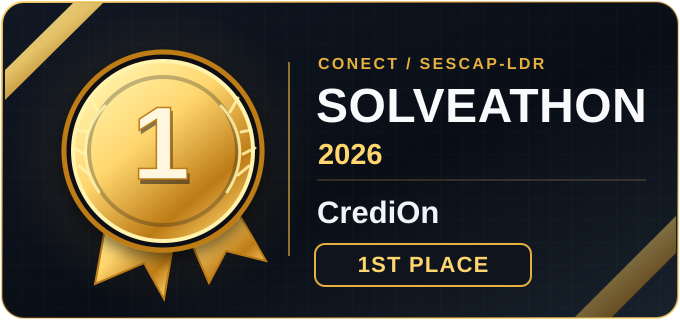
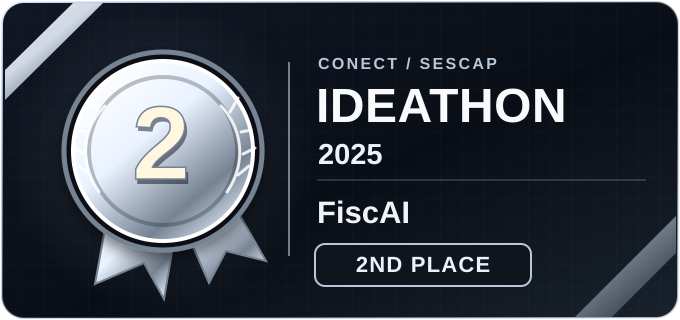
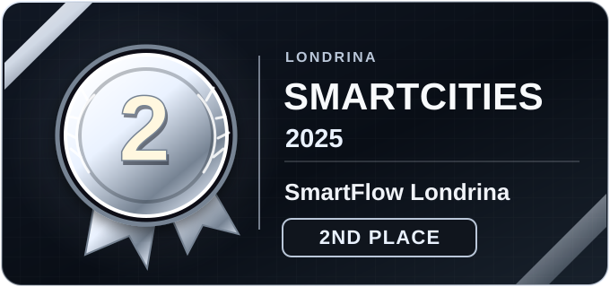
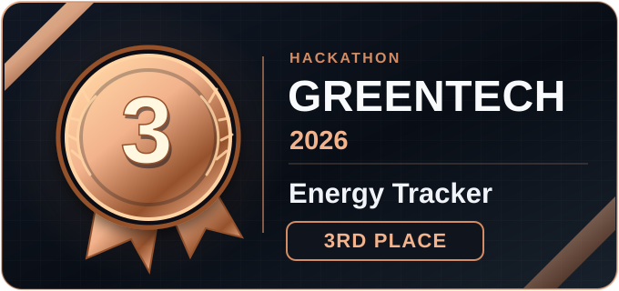
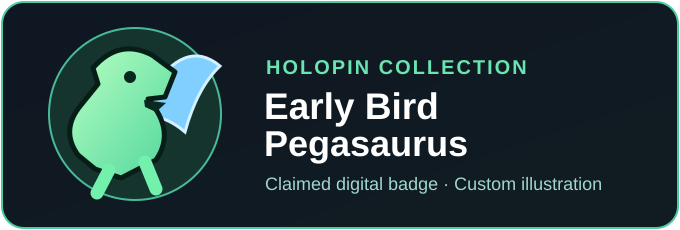

<div align="center">


**Backend-first mindset · Full Stack delivery · Real-world automation**

<a href="https://github.com/LEONELZANINELLI"></a>
<a href="https://www.linkedin.com/in/leonel-zaninelli-de-souza/"></a>


</div>

---

<h2 align="center">👨‍💻 About Me</h2>

I'm **Leonel Zaninelli**, a Brazilian software developer working professionally as a **Full Stack Developer at Contabiliza**, with a strong focus on **backend development using Java and Spring Boot**. I'm also studying **Software Engineering at UniFil**.

I enjoy designing REST APIs, integrating services, working with relational databases, and automating workflows that would otherwise require repetitive manual work. When a project needs an interface, I build with **React, TypeScript, Vite and Tailwind CSS**.

My current growth areas are **software architecture, API performance, testing, scalability and clean code**. I like practical solutions: clear contracts, maintainable code, and technology choices that match the problem.

<div align="center">

`Java` · `Spring Boot` · `REST APIs` · `PostgreSQL` · `Docker` · `TypeScript` · `React`

</div>

---

<h2 align="center">⚙️ Developer Profile</h2>

| Area | Snapshot |
| --- | --- |
| 💼 **Current role** | Full Stack Developer — Contabiliza (since May 2026) |
| 🎯 **Main direction** | Backend engineering with Java and Spring Boot |
| ☕ **Backend** | Java 21 · Spring Boot · REST · JPA/Hibernate |
| 🗄️ **Data** | PostgreSQL · SQL · relational modeling |
| 🌐 **Frontend** | React · TypeScript · Vite · Tailwind CSS |
| 🤖 **Automation** | Python · FastAPI · scripting · external API integration |
| 🐳 **Engineering tools** | Docker · Git/GitHub · IntelliJ IDEA · VS Code |
| 🎓 **Education** | Software Engineering — UniFil (started 2025) |
| 📍 **Location** | Paraná, Brazil 🇧🇷 |

---

<h2 align="center">💼 Experience & Impact</h2>

### 🏢 Contabiliza — Full Stack Developer

Building and evolving **internal business systems, integrations and workflow automation** in the accounting domain. Selected contributions:

- **NFS-e management:** backend APIs and interfaces for handling electronic service invoices and related integrations.
- **Desktop tooling:** an internal tools hub using **Tauri 2, React and TypeScript**, with persistent preferences and a unified user experience.
- **Fiscal process automation:** batch routines and integrations with external services to reduce repetitive manual consultations.
- **Reporting and dashboards:** business metrics, document processing, report generation and data visualization.
- **Web applications:** institutional interfaces and tax-simulation experiences integrated with business workflows.
- **Engineering practice:** Git-based versioning, API design, SQL, debugging, Docker environments and end-to-end delivery.

> Professional projects are summarized at a high level; private repositories and internal implementation details remain private.

### 🎓 UniFil — NPI Programming Monitor

Previously supported programming and web-development activities for students and the local community, including programming fundamentals and introductory web development.

---

<h2 align="center">🧰 Tech Stack</h2>

<div align="center">

**Backend & Databases**


`Java` · `Spring Boot` · `REST` · `JPA/Hibernate` · `PostgreSQL` · `Python` · `FastAPI`

<br/>

**Frontend & Desktop**


`React` · `TypeScript` · `JavaScript` · `Vite` · `Tailwind CSS` · `Tauri`

<br/>

**Tools & Workflow**


`Docker` · `Git/GitHub` · `IntelliJ IDEA` · `VS Code` · `API Testing`

</div>

---

<h2 align="center">🚀 Selected Public Projects</h2>

| Project | What it demonstrates | Technologies |
| --- | --- | --- |
| ⚡ [API Performance Lab](https://github.com/LEONELZANINELLI/api-performance) | Work-in-progress playground for benchmarking API design and performance | Java · Spring Boot · PostgreSQL · Docker |
| 📚 [Study Manager API](https://github.com/LEONELZANINELLI/study-manager-api) | Backend application for study organization | Java |
| 🏦 [BankJava](https://github.com/LEONELZANINELLI/Projeto-BankJava) | Banking domain logic and object-oriented programming | Java · OOP |
| 🤖 [FiscAI — Ideathon](https://github.com/LEONELZANINELLI/Ideathon-Sescap) | Tax intelligence prototype developed in a hackathon | Web · AI |
| 📖 [Library MVC](https://github.com/LEONELZANINELLI/Desenvolvimento-Web-MVC-b4) | Server-rendered library management exercise | Java · Spring MVC · Thymeleaf |
| 🍳 [Pitadi](https://github.com/LEONELZANINELLI/pitadi-flutter) | Recipe application developed for mobile coursework | Flutter · Dart |
| 🌤️ [Clima Fácil](https://github.com/LEONELZANINELLI/clima-facil-streamlit) | Weather application consuming public APIs | Python · Streamlit |

<sub>Some projects are academic, prototypes, or actively in development; repositories document their current scope.</sub>

---

<h2 align="center">🏗️ Engineering Work</h2>

| Focus | Selected work |
| --- | --- |
| **Backend & integrations** | Spring Boot APIs, NFS-e workflows, relational data and external services |
| **Business automation** | Fiscal consultations, document-processing routines and batch workflows |
| **Desktop & frontend** | Tauri + React + TypeScript tools hub; forms, dashboards and web interfaces |
| **Reports & analytics** | Operational dashboards, historical comparisons and report generation |
| **Performance & architecture** | Personal API performance lab; ongoing studies in scalability, testing and architectural patterns |

---

<h2 align="center">🏆 Hackathon Awards</h2>

<div align="center">

**Four podium finishes in innovation and technology competitions**

<table>
<tr>
<td width="50%" align="center"></td>
<td width="50%" align="center"></td>
</tr>
<tr>
<td width="50%" align="center"></td>
<td width="50%" align="center"></td>
</tr>
</table>

</div>

| Result | Challenge & solution |
| --- | --- |
| 🥇 **1st — Solveathon CONECT / SESCAP-LDR (2026)** | **CrediOn:** tax-credit predictability, supplier analysis and cash-flow support |
| 🥈 **2nd — Ideathon CONECT / Sescap (2025)** | **FiscAI:** AI-enabled tax intelligence platform |
| 🥈 **2nd — SmartCities Londrina (2025)** | **SmartFlow Londrina:** intelligent monitoring of people flow |
| 🥉 **3rd — GreenTech Hackathon (2026)** | **Energy Tracker:** IoT energy monitoring concept |

<sub>Medal artwork is custom-made for this profile and represents competition results; it is not an official event-issued digital credential.</sub>

---

<h2 align="center">🦖 Holopin Badge Collection</h2>

<div align="center">

<a href="https://www.holopin.io/">
  
</a>

**Early Bird Pegasaurus** — claimed on **Holopin**.

<sub>The illustration above is custom artwork, not the official Holopin credential image. The verified badge remains on Holopin.</sub>

</div>

<!-- Add the live Holopin board embed from your own Holopin profile here after confirming your Holopin username; do not publish private claim/coupon URLs. -->

---

<h2 align="center">🎯 Current Focus</h2>

```text
BACKEND ENGINEERING     Java · Spring Boot · REST APIs
DATA & INTEGRATIONS     PostgreSQL · SQL · External APIs
DELIVERY & AUTOMATION   Docker · Internal Tools · Workflows
LEARNING NEXT           Testing · Performance · Architecture
```

My goal is to grow as a **backend engineer**, building reliable, observable and maintainable services while staying comfortable delivering complete solutions when needed.

---

<h2 align="center">📊 GitHub Analytics</h2>

<div align="center">




</div>

---

<div align="center">

<picture>
  <source media="(prefers-color-scheme: dark)" srcset="https://raw.githubusercontent.com/LEONELZANINELLI/LEONELZANINELLI/output/github-contribution-grid-snake-dark.svg"/>
  <source media="(prefers-color-scheme: light)" srcset="https://raw.githubusercontent.com/LEONELZANINELLI/LEONELZANINELLI/output/github-contribution-grid-snake.svg"/>
  
</picture>

</div>

---

<h2 align="center">📫 Connect</h2>

<div align="center">

<a href="https://github.com/LEONELZANINELLI"></a>
<a href="https://www.linkedin.com/in/leonel-zaninelli-de-souza/"></a>

<br/><br/>

**Building reliable software, one commit at a time.**

<br/>


</div>


